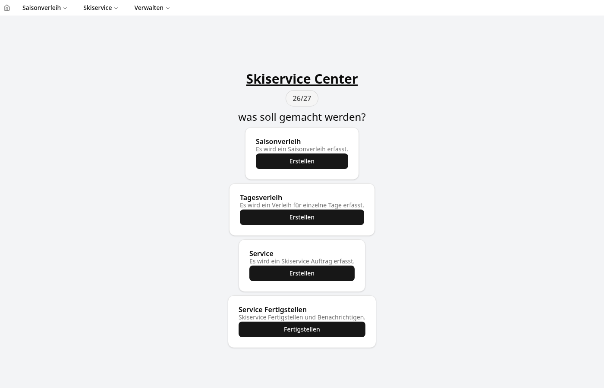
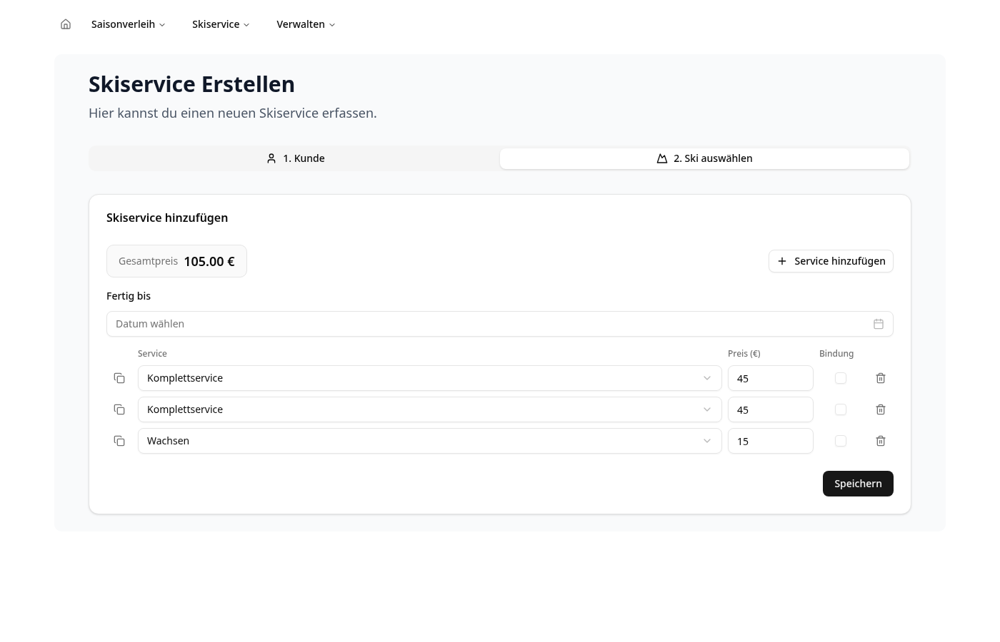
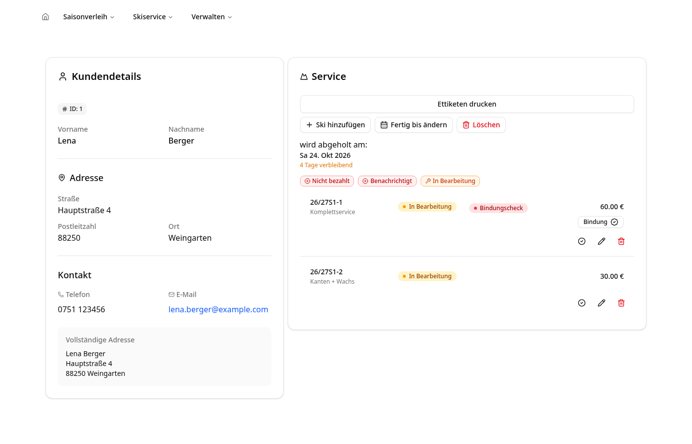
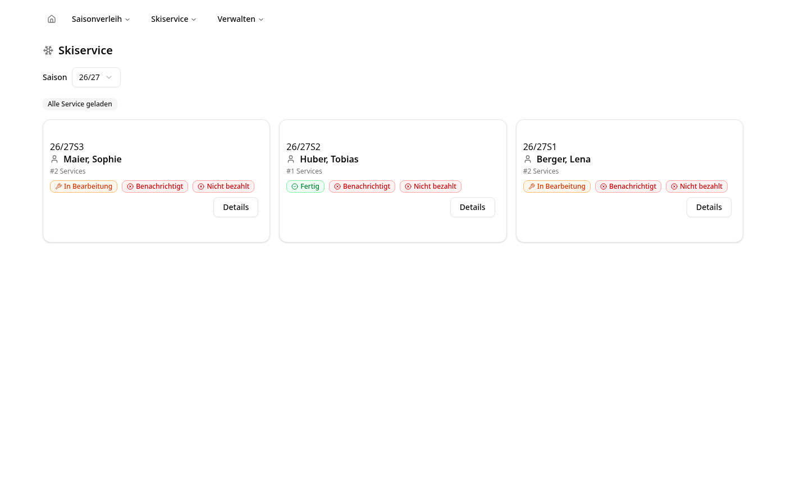
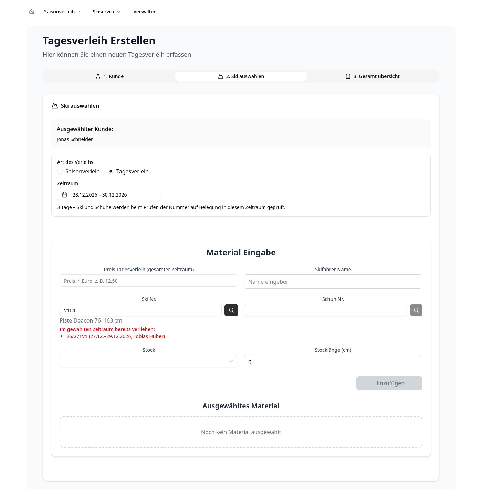
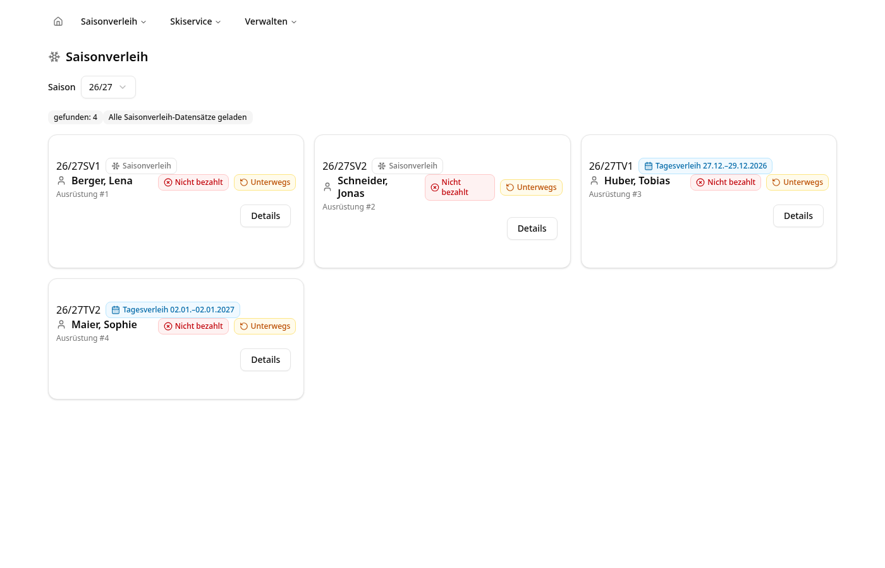
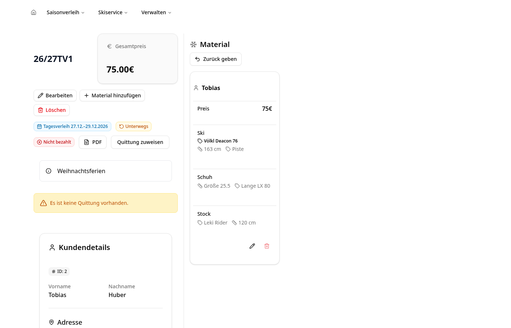
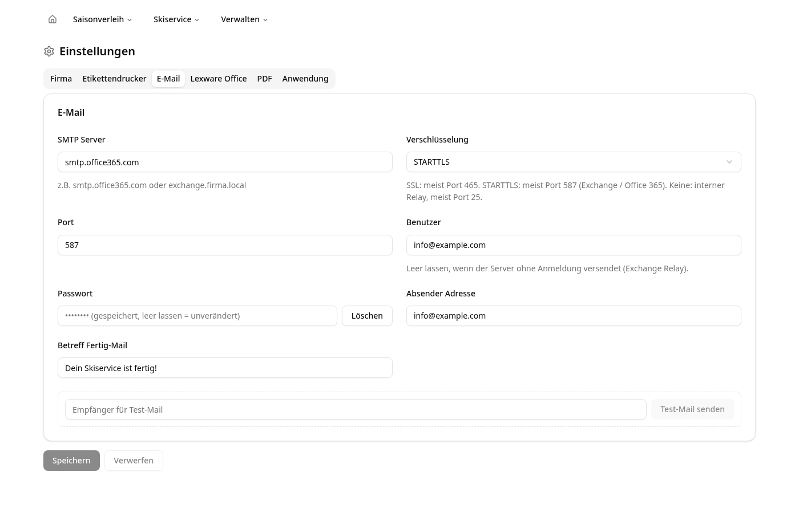
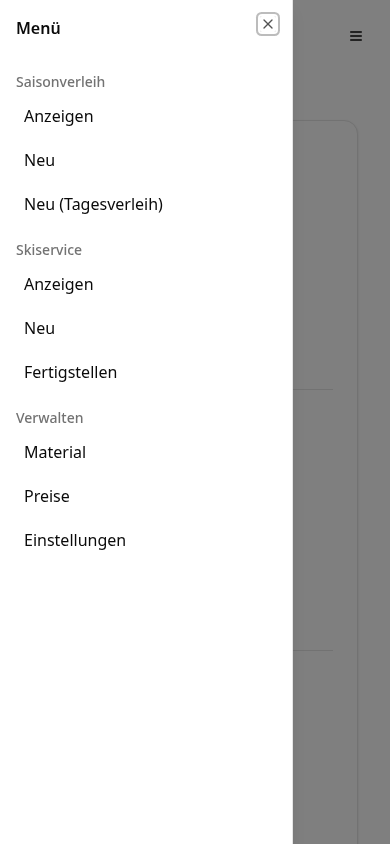
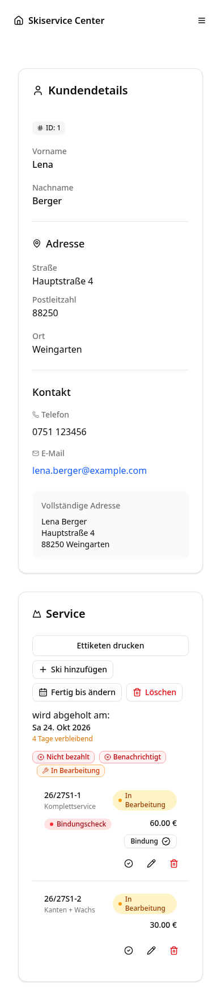

# Skiservice Center

Verwaltungsoberfläche für die Mitarbeiter im Skiservice: Kunden, Skiservice-Aufträge, Saison- und Tagesverleih, Material, Preise und Einstellungen. Alle Daten kommen aus der [Skiservice API](https://github.com/SimonLoeffler1993/skiserviceapi).



## Funktionen

### Skiservice

Aufträge mit mehreren Ski erfassen. Zeilen lassen sich duplizieren, der Gesamtpreis wird laufend berechnet. Nach dem Speichern werden die Etiketten gedruckt.



Ist „Bindung“ angehakt, lassen sich optional die Bindungsdaten erfassen (Fahrer, Sohle, Gewicht, Größe, Fahrkönnen, Alter). „Letzte Daten abfragen“ zeigt die früheren Einträge des Kunden. Ein übernommener Eintrag wird beim Speichern archiviert, nicht mehr benötigte Einträge lassen sich dort auch von Hand archivieren.

In der Detailansicht können Ski hinzugefügt, bearbeitet, entfernt und zwischen *offen* und *fertig* umgeschaltet werden. Abholdatum ändern und Auftrag löschen sind ebenfalls möglich. Bezahlte Aufträge sind gesperrt.



| Liste | Fertigstellen per Scanner |
|---|---|
|  | Seite `/fertig`: Ski scannen, fertigmelden, Kunde wird per Mail benachrichtigt |

### Saison- und Tagesverleih

Beim **Tagesverleih** wird ein Zeitraum gewählt und der Preis frei eingetragen. Ski und Schuhe werden beim Prüfen der Nummer darauf geprüft, ob sie im Zeitraum schon verliehen sind – in einem anderen Tagesverleih oder einem nicht zurückgegebenen Saisonverleih.



Art und Zeitraum stehen in der URL und lassen sich direkt verlinken:

| URL | Ergebnis |
|---|---|
| `/saisonverleih/erstellen` | Saisonverleih |
| `/saisonverleih/erstellen?art=tag` | Tagesverleih, Zeitraum noch offen |
| `/saisonverleih/erstellen?art=tag&von=2026-12-27&bis=2026-12-29` | Tagesverleih mit Zeitraum |

| Übersicht | Detail |
|---|---|
|  |  |

In der Detailansicht können Bemerkung, Art und Zeitraum geändert, Material hinzugefügt, bearbeitet und entfernt sowie der Verleih gelöscht werden.

### Material

Unter **Verwalten → Material** lassen sich Ski, Schuhe, Stöcke, Hersteller, Skiarten und Modelle anlegen, bearbeiten und entfernen.

- Der Entfernen-Dialog zeigt vorab, was passiert:
  - Unbenutztes Material kann ausgemustert oder endgültig gelöscht werden.
  - Material in Verleihen kann nur ausgemustert werden. Der Dialog listet die betroffenen Verleihe mit Link auf.
- Ausgemustertes Material verschwindet aus der Auswahl im Verleih, lässt sich über „Ausgemusterte anzeigen“ wieder einblenden und wiederherstellen.
- Hersteller und Modelle lassen sich nur löschen, wenn nichts mehr darauf verweist.
- Ändert sich eine Ski-Nr., werden bestehende Verleihe automatisch umgestellt.
- Schuhe können eine eigene Schuh-Nr. bekommen (z. B. Inventur-Aufkleber), sonst gilt die fortlaufende Nummer.

### Einstellungen

Unter **Verwalten → Einstellungen** werden Firma, Etikettendrucker, E-Mail (SSL, STARTTLS oder ohne Verschlüsselung), Lexware und Nummernkürzel gepflegt. Passwörter werden nie angezeigt, nur ob sie gesetzt sind. Mail, Drucker und Lexware lassen sich direkt testen.



### Handy und Tablet

Auf kleinen Bildschirmen klappt das Menü seitlich aus, Formulare und Listen stapeln sich.

| Menü | Auftrag |
|---|---|
|  |  |

## Konfiguration

| Variable | Beschreibung |
|---|---|
| `BACKEND_URL` | Adresse der Skiservice API, z. B. `http://skiserviceapi:8000`. Standard: `http://localhost:8000` |

Die Seite `/fertig` verbindet sich per WebSocket **aus dem Browser** mit der API. Dafür muss `BACKEND_URL` auch vom Browser aus erreichbar sein.

Alle anderen Einstellungen liegen in der Datenbank und werden in der Oberfläche gepflegt.

## Entwicklung

```bash
npm install
BACKEND_URL=http://localhost:8000 npm run dev   # http://localhost:3000
npm run lint
npm run build
```

### Aufbau

| Ordner | Inhalt |
|---|---|
| `src/app/` | Seiten (App Router) |
| `src/lib/*actions.ts` | Server Actions, die die API aufrufen (`"use server"`) |
| `src/hooks/use*Options.ts` | TanStack-Query-Optionen für die Server Actions |
| `src/types/` | zod-Schemas und Typen |
| `src/context/` | seitenweiter Zustand, z. B. der Verleih während der Erfassung |
| `src/components/ui/` | shadcn/ui-Komponenten (über die shadcn-CLI hinzufügen) |

Die Saisons werden zentral geladen und 5 Minuten im Server gecacht. Ist das Backend nicht erreichbar, zeigt das Center eine Meldung mit „Erneut versuchen“.

## Docker

Bei jedem Push auf `master` baut GitHub Actions das Image `ghcr.io/simonloeffler1993/skiservice-center:latest` (Next.js standalone, Port 3000). Ein Beispiel für den kompletten Stack liegt im Repository der API unter `docker/alles/`.
